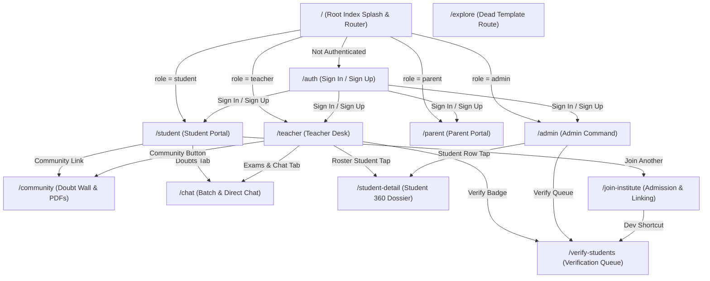

# ACADLY MOBILE APP: COMPLETE PRODUCT ARCHITECTURE, FLOWS & DESIGN AUDIT REPORT

> **Document Type:** Product Architecture, User Flows, Data Model & Design System Audit  
> **Target Audience:** Product Designers, UI/UX Engineers, and Engineering Leadership  
> **Codebase Target:** React Native 0.88.1 / Expo SDK 58.0.22 / Expo Router 58.0.29 / Supabase  
> **Inspection Date:** November 2026  
> **Audit Status:** Ground-Truth Codebase Inspection (Actual Runtime Code vs. Intended Specs)

---

## 1. PRODUCT OVERVIEW

### 1.1 Core Mission & Target Audience (5–10 Lines)
Acadly is a cross-platform mobile application designed for hyper-local private coaching institutes, competitive exam test prep centers (IIT-JEE, NEET, Olympiads, CBSE Boards), and independent solo tuition teachers in India. It aims to bridge the daily communication gap between private tutors, enrolled students, and parents. The app replaces unorganized WhatsApp group broadcasts and paper registers by centralizing attendance tracking with parent absentee alerts, PDF study material sharing (DPPs, formula sheets), assignment submissions with teacher grading, YouTube/Bunny video lectures, fee recovery with instant receipt generation, and peer-to-peer doubt resolution.

### 1.2 Coaching Institute vs. Formal School Reality
While the codebase occasionally uses school-like labels in UI mocks (e.g., "Delhi Public School", "Class 10 CBSE"), **90% of the architecture, terminology, database schema, and user flows assume a Coaching Institute or Solo Private Tutor model, NOT a K-12 School.**

#### Direct Code & Data Model Evidence:
1. **"Batches" instead of "Classes & Sections":**
   - The primary grouping entity throughout the app is `batch` (`batch_id`, `batchName`, `batches` table).
   - Real batches in the codebase: `Class 12 • JEE Advanced (Morning)`, `NEET-UG • Target 680+ Batch`, `Class 11 • Physics & Calculus Mastery`.
   - A traditional school uses permanent class sections (e.g., `Grade 8-B`, `Class 10-A`) with homeroom teachers; Acadly uses time-slotted coaching batches (`start_time: '07:30 AM'`, `room_number: 'Hall A'`).
2. **Teacher Invite & Admission Codes:**
   - In `src/app/auth.tsx` and `src/app/teacher.tsx`, solo teachers generate proprietary codes (`JOSHI-MATH-89`, `<LASTNAME>-<SUBJECT>-26`) and coaching centers generate invite codes (`BLOOM2026`, `STAR2026`). Students join teachers directly via `src/app/join-institute.tsx` by entering these codes. A formal school enrolls students via an administrative registrar, never by having 14-year-olds type teacher codes to connect to a physics teacher.
3. **Competitive Exam & Board Specialization:**
   - The student model (`Student` in `src/types/database.ts` and `StudentExtraDetails` in `src/context/AcademicContext.tsx`) demands fields like `targetExam` (`IIT-JEE 2026`, `NEET-UG`), `previousPercentage` (`96.2%`), and `weakSubjects` (`Rotational Dynamics, Wave Optics`). These are test-prep coaching inputs, not elementary/secondary school enrollment forms.
4. **Per-Teacher / Course-Based Tuition Fees:**
   - The fee engine (`StudentFee`, `FeePlan` in `src/types/database.ts` and `src/context/FeeNotificationContext.tsx`) models coaching tuition plans (`Class 12 JEE Annual Comprehensive: ₹85,000`, `Monthly Advanced Physics: ₹3,500`). It calculates per-student balances and outstanding collection rates rather than multi-installment school tuition, term fees, bus fees, library dues, and laboratory caution deposits.
5. **Solo Tutor Dual Mode:**
   - In `src/app/auth.tsx` (lines 75–85, 160–210), teachers can register as an "Independent Solo Tutor" (who manages their own students, fees, and codes) or "Coaching Center Faculty" (linked to an institute code). Formal schools do not have independent solo tutors operating inside their ERP.

### 1.3 Branding & Institute-Level Configuration
- **App Name:** Acadly (internal package name `acadly`, display title `Acadly`).
- **Brand Tagline:** *"Where learning feels like joy"* (also found in legacy strings as *"Where curious minds blossom into stars"*).
- **Institute Multi-Tenancy:**
  - In theory, multi-tenant via `Institute` entity (`id`, `name`, `code`, `center_code`, `city`, `logo_url`).
  - In practice, two competing hardcoded institute rosters exist in code:
    1. `DEFAULT_INSTITUTES` in `src/context/AuthContext.tsx`: `Apex Coaching Institute (KOTA-01)`, `Pinnacle IIT-JEE Hub (DEL-02)`, `Zenith Medical Forum (PUN-03)`.
    2. `DEFAULT_CUTE_INSTITUTES` in `src/context/InstituteContext.tsx`: `Bloom Academy (PUNE-01, BLOOM2026)` and `Starlight Coaching Hub (BLR-01, STAR2026)`.
  - Institute settings (logo, address, contact phone, fee policies) cannot currently be edited dynamically by admins through a persistent UI screen; they reset to in-memory mock defaults on reload.

---

## 2. ROLES & PERMISSIONS

Acadly defines five distinct user roles: **Coaching Center Admin**, **Solo Tutor**, **Coaching Faculty**, **Student**, and **Parent**.

```
                ┌──────────────────────────────────────────────┐
                │             COACHING CENTER ADMIN            │
                │   (Creates Batches, Broadcasts Alerts,       │
                │    Oversees Institute Dues, Approves Joins)  │
                └──────────────────────┬───────────────────────┘
                                       │ Employs / Invites (Invite Code)
                                       ▼
 ┌──────────────────────┐      ┌───────────────────────────────┐
 │     SOLO TUTOR       │      │       COACHING FACULTY        │
 │  (Generates Teacher  │      │  (Assigned to Institute       │
 │   Code, Own Rosters, │      │   Batches, Marks Roll Call,   │
 │   Collects Fees)     │      │   Publishes Materials)        │
 └──────────┬───────────┘      └───────────────┬───────────────┘
            │                                  │
            │ Approves Join Requests           │ Marks Attendance / Grades Work
            ▼                                  ▼
 ┌─────────────────────────────────────────────────────────────┐
 │                           STUDENT                           │
 │   (Attends Batches, Watches Videos, Downloads PDFs,         │
 │    Submits DPPs, Asks Doubts in Chat / Community)           │
 └──────────────────────────────┬──────────────────────────────┘
                                │ Linked via Student Code (e.g. STU-AMELIA-902)
                                ▼
 ┌─────────────────────────────────────────────────────────────┐
 │                           PARENT                            │
 │   (Monitors Child Attendance, Reviews Performance Charts,   │
 │    Pays Outstanding Tuition via Razorpay, Downloads Invoices│
 └─────────────────────────────────────────────────────────────┘
```

### 2.1 Role-by-Role Breakdown

#### 1. Student (`student`)
- **Acquisition / Onboarding:**
  1. Signs up on `/auth` with Name, Email, Password.
  2. Prompted to enter a Teacher Code or Coaching Center Code on `/join-institute`.
  3. Fills an 11-field academic profile (Grade, Board, Target Exam, School, Previous %, Weak Topics, Guardian Phone).
  4. Waits in `pending` queue until the teacher or admin approves them.
- **Capabilities (What they CAN do):**
  - View enrolled batches, daily schedules, and enrolled teachers.
  - View attendance percentage and personal rank/percentile in batch.
  - Browse study materials (PDFs) and generate printable preview documents.
  - Stream published video lectures (YouTube iframe).
  - Submit assignment solutions (PDF/image picker with submission notes).
  - View test score breakdown and SVG comparison charts.
  - Chat in batch discussion channels and direct 1-on-1 tutor rooms.
  - Post questions on the community doubt wall and upvote peer answers.
  - View their Student ID card and parent link code.
- **Restrictions (What they CANNOT do):**
  - Cannot mark attendance or edit scores.
  - Cannot publish study materials or lectures.
  - Cannot approve other students or see other students' fees.
  - Cannot mark answers as "Verified" on the community wall.

#### 2. Solo Tutor (`teacher` with `teacherMode: 'solo'`)
- **Acquisition / Onboarding:**
  - Signs up on `/auth` selecting "Teacher" -> "Solo Tutor".
  - Enters qualifications, subjects, experience, fee rate.
  - Code auto-generates a shareable teacher code (e.g., `JOSHI-MATH-89`).
- **Capabilities:**
  - Owns their student roster directly; admits students via `/verify-students`.
  - Conducts daily roll call with Present (P), Absent (A), Late (L) toggles.
  - Corrects attendance records with an audit reason modal.
  - Triggers absentee notification alerts to parents.
  - Uploads PDF study notes, formula sheets, and past-year question banks.
  - Publishes video lectures and creates assignments with due dates.
  - Grades student submissions with numerical marks and text feedback.
  - Publishes test scores and manages batch discussions.
  - Copies and shares their teacher code via WhatsApp or native share sheet.
- **Restrictions:**
  - Does not have institute-level analytics or multi-teacher oversight.

#### 3. Coaching Faculty (`teacher` with `teacherMode: 'coaching_faculty'`)
- **Acquisition / Onboarding:**
  - Signs up on `/auth` selecting "Teacher" -> "Coaching Center Faculty".
  - Enters the Coaching Center's Invite Code (`BLOOM2026`).
- **Capabilities:**
  - Same academic capabilities as Solo Tutor (attendance, grading, PDFs, lectures).
  - Tied to the institute's shared batches and rooms.
- **Restrictions:**
  - Cannot change institute-level settings or fee structures.
  - Does not manage center admissions (handled by Institute Admin).

#### 4. Parent (`parent`)
- **Acquisition / Onboarding:**
  - Signs up on `/auth` selecting "Parent".
  - Enters child's student link code (e.g., `STU-AMELIA-902`) or registered phone number.
- **Capabilities:**
  - Switch between multiple linked children (`Amelia Sharma`, `Aarav Sharma`).
  - View real-time attendance status (Today's check-in: Present/Absent).
  - Review 6-month attendance consistency ring charts.
  - Review academic marks and benchmark comparison charts.
  - View outstanding fee invoices and due dates.
  - Trigger "Pay via Razorpay" (opens mock checkout modal).
  - View and download GST tax receipts (via `expo-print` & `expo-sharing`).
  - 1-tap call or WhatsApp message to assigned batch teachers.
- **Restrictions:**
  - Read-only access to academic data (cannot edit attendance or submit assignments).
  - Cannot post on the student community wall or join student-only chat rooms.

#### 5. Coaching Center Admin (`admin`)
- **Acquisition / Onboarding:**
  - Signs up on `/auth` selecting "Admin / Coaching Director".
  - Enters Institute Name (`Bloom Science Academy`), City, Subjects, Phone.
  - Generates an Institute Join Code (e.g., `BLOO-8491`).
- **Capabilities:**
  - View center-wide KPIs: Total Active Batches, Enrolled Students, Recovery %.
  - Create new batches (Name, Subject, Teacher, Time, Room).
  - Review and approve pending student admissions.
  - View overdue fee accounts and trigger fee collection alerts.
  - Broadcast center-wide push notification alerts.
- **Restrictions:**
  - Does not conduct daily student-by-student attendance roll calls (delegated to faculty).

### 2.2 Multi-Role Switching & Linkage Enforcement

```
┌─────────────────────────────────────────────────────────────────────────────┐
│                       MULTI-ROLE SWITCHING REALITY                          │
│                                                                             │
│  In Code (AuthContext.tsx lines 164-169):                                   │
│  switchRole(role) {                                                         │
│    setUserRole(role);                                                       │
│    setUser(ROLE_PROFILES[role]); // <-- OVERWRITES IDENTITY ENTIRELY!      │
│    AsyncStorage.setItem('@acadly_role', role);                              │
│  }                                                                          │
│                                                                             │
│  Result: A user does NOT retain their profile when switching roles.         │
│  Switching from Teacher to Parent swaps 'Prof. Vikram Joshi' with           │
│  'Priya Sharma' in memory!                                                  │
└─────────────────────────────────────────────────────────────────────────────┘
```

#### How Linkages Are Enforced in Code:
1. **Teacher ↔ Student:**
   - Enforced in `src/context/AcademicContext.tsx` via `JoinRequest` and `studentsRoster`. When a teacher approves a student, the student is pushed to `studentsRoster` and `enrolledTeachers`.
   - In Supabase migrations (`001_complete_schema.sql`), this is modeled as `batch_enrollments` (`batch_id`, `student_id`).
2. **Parent ↔ Child:**
   - Enforced in `src/context/ChildContext.tsx` via `parent_student_mappings` query or fallback `DEFAULT_CHILDREN` array.
   - Enforced in UI by matching `parent_code` (e.g. `STU-AMELIA-902`).
3. **Teacher / Student ↔ Admin:**
   - Enforced via `institute_members` (`institute_id`, `user_id`, `role`).
   - In the local state, it checks whether `codeUsed` matches the center's `inviteCode`.

---

## 3. USER JOURNEYS

### 3.1 First-Time Onboarding Journeys

#### Student Onboarding:
1. Opens app -> Lands on `/auth` (mode: `Sign In`).
2. Taps "Need an account? Sign Up" -> Selects "Student" pill.
3. Enters Full Name, Email, Password -> Taps "Create Student Account".
4. Prompted with modal: *"Now enter your Teacher Code or Coaching Code"* -> Taps "Connect Teacher Code".
5. Navigated to `/join-institute`.
6. **Step 1:** Types Teacher Code `JOSHI-MATH-89` -> System validates code and displays matched tutor name (`Prof. Vikram Joshi • Mathematics`).
7. **Step 2:** Fills extended form: Grade (`Class 11 Science`), Board (`CBSE`), Target Exam (`IIT-JEE 2026`), School, Previous %, Weak Topics, Guardian Name & Phone.
8. **Step 3:** Reviews summary and taps "Submit Application".
9. **Stuck / Confusing State:** Screen lands on a success card saying *"Application Submitted! Awaiting Teacher Approval"*. However, right beneath it is a button saying *"Open Teacher Verification Desk"* which pushes `/verify-students`. A student can literally open the teacher's approval screen from their own phone!

#### Solo Teacher Onboarding:
1. Opens `/auth` -> Taps "Sign Up" -> Selects "Teacher" pill.
2. Selects "Independent Solo Tutor" radio option.
3. Enters Name (`Prof. Vikram Joshi`), Qualifications, Subjects (`Physics, Calculus`), Fee (`3500`).
4. Taps "Create Teacher Account" -> Receives dialog: *"Your shareable Teacher Code is: JOSHI-MATH-89"*.
5. Taps "Open Teacher Desk" -> Lands on `/teacher` (Home Tab).
6. Sees their Teacher Code banner with 1-tap WhatsApp and Share buttons.

#### Parent Onboarding:
1. Opens `/auth` -> Taps "Sign Up" -> Selects "Parent" pill.
2. Enters Name (`Priya Sharma`), Email, Password.
3. Prompted with child link input: enters `STU-AMELIA-902`.
4. Taps "Create Parent Account" -> Lands on `/parent` with `Amelia Sharma` pre-selected.

---

### 3.2 Daily Use Flows

#### Teacher Morning Routine:
1. Teacher logs in -> Lands on `/teacher` (Home tab).
2. Taps bottom tab "Roster" -> Selects batch chip `Class 12 • JEE Advanced (Morning)`.
3. Reviews roll call list -> Taps `P` / `A` / `L` pills for each student.
4. For any student marked `A` (Absent), taps "Absentee Ping" -> Native alert confirms: *"Absentee alert queued for parents via SMS/WhatsApp"*.
5. If an attendance record was recorded wrongly, taps "Audit" -> Enters correction reason (e.g., *"Student arrived 15 mins late with medical note"*) -> Changes status to `Late`.
6. Taps "Publish" tab -> Uploads today's Daily Practice Problem (DPP) PDF or creates an assignment with due date.

#### Student Evening Routine:
1. Student opens app -> Lands on `/student` (Home tab).
2. Checks "Today's Attendance": Confirms `Present` badge.
3. Taps "Study Hub" tab -> Opens "Assignments" sub-tab.
4. Taps "Submit Work" on `Physics DPP #14` -> Attaches homework PDF (`amelia_gauss_solution.pdf`) -> Submits.
5. Taps "Study Materials" -> Taps "View & Share PDF" on `Rotational Dynamics Formula Sheet` -> Opens PDF preview.
6. Taps "Doubts" tab -> Navigates to `/chat` -> Messages tutor about question #4.

#### Parent Weekly Routine:
1. Parent opens app -> Lands on `/parent`.
2. Inspects child's monthly attendance ring (96.4%).
3. Switches to "Fees & Invoices" tab -> Sees pending fee ₹85,000 due in 12 days.
4. Taps "Pay via Razorpay" -> Mock checkout sheet slides up -> Selects "UPI" -> Taps "Pay ₹85,000".
5. 1.2-second spinner executes -> Success checkmark -> GST receipt modal opens with receipt number `APX-REC-2025-XXXX`.
6. Taps "Download PDF Invoice" -> PDF generated and system share dialog opens.

---

### 3.3 Dead Ends, Stuck Points & UX Glitches

```
┌─────────────────────────────────────────────────────────────────────────────┐
│                            NOTABLE DEAD ENDS                                │
├─────────────────────────────────────────────────────────────────────────────┤
│ 1. Student /verify-students Loophole:                                       │
│    In /join-institute, a student who just submitted an admission request is │
│    given an 'Open Teacher Verification Desk' button, letting them see and   │
│    approve their own admission.                                             │
│                                                                             │
│ 2. Unlinked Chat & Community Navigation:                                    │
│    Neither /chat nor /community has a Bottom Navigation Bar. Once pushed,   │
│    the user can only tap the top-left back arrow to return.                 │
│                                                                             │
│ 3. Fake Video Offline Download:                                             │
│    In VideoPlayerModal.tsx, tapping 'Download Offline' toggles an ID in a   │
│    React state array. It does not download any video bytes. If the user     │
│    turns off Wi-Fi, the YouTube iframe fails with a network error.          │
│                                                                             │
│ 4. Fake Razorpay Gateway:                                                   │
│    Tapping 'Pay' in RazorpayCheckoutModal.tsx runs a 1200ms setTimeout and  │
│    fabricates a fake pay_xxx string. No real payment or bank charge occurs. │
│                                                                             │
│ 5. Orphaned Explore Screen:                                                 │
│    src/app/explore.tsx exists in the routing tree but has no inbound links. │
│    It is a leftover from the default Expo boilerplate.                      │
└─────────────────────────────────────────────────────────────────────────────┘
```

---

## 4. NAVIGATION MAP

### 4.1 Route Architecture & Bottom Navigation

The app uses **Expo Router** with a root `Stack` in `src/app/_layout.tsx`. Bottom navigation is implemented via a shared custom component: `src/components/ui/BottomTabBar.tsx`, docked inside `ScreenWrapper.tsx`.



### 4.2 Bottom Bar Tabs per Role

| Role | Tab 1 | Tab 2 | Tab 3 | Tab 4 | Tab 5 |
| :--- | :--- | :--- | :--- | :--- | :--- |
| **Student** | `Home` (`/student`) | `Study Hub` (`/student`) | `Analytics` (`/student`) | `Doubts` (`/chat` or internal) | `Profile` (`/student`) |
| **Teacher** | `Home` (`/teacher`) | `Roster` (`/teacher`) | `Publish` (`/teacher`) | `Exams & Chat` (`/teacher`) | `Profile` (`/teacher`) |
| **Parent** | `Home` (`/parent`) | `Children` (`/parent`) | `Fees & Invoices` (`/parent`) | `Profile` (`/parent`) | *(4 tabs total)* |
| **Admin** | `Home` (`/admin`) | `Batches` (`/admin`) | `Admissions & Dues` (`/admin`) | `Center Profile` (`/admin`) | *(4 tabs total)* |

---

## 5. SCREEN-BY-SCREEN BREAKDOWN

### 1. Root Index / Splash (`src/app/index.tsx`)
- **Route:** `/` | **Line Count:** 41 lines | **Split Needed?** No.
- **Purpose:** Checks authentication state and redirects to `/auth` or the appropriate role portal.
- **Top-to-Bottom Layout:**
  - Full-screen centered container with background `#FAF7F2`.
  - Mascot component (`happy`, `size="lg"`).
  - Title and subtitle text with corrupted UTF-8 characters (`Acadly dYO,`, `Where learning feels like joy o"`).
  - ActivityIndicator spinner in peach `#FF7D6B`.
- **Data Source:** `useAuth()` (`user`, `userRole`, `loading`).
- **Interactive Elements:** None (automatic redirect).
- **Known Bugs:** Corrupted emoji characters rendered in raw text.

---

### 2. Authentication & Onboarding (`src/app/auth.tsx`)
- **Route:** `/auth` | **Line Count:** 855 lines | **Split Needed?** **YES (Urgent).** Split into `SignInForm`, `TeacherSignUpForm`, `StudentSignUpForm`, `ParentSignUpForm`, and `ForgotPasswordModal`.
- **Purpose:** Handles user sign-in, multi-role registration, solo tutor setup, and password resets.
- **Top-to-Bottom Layout:**
  - Hero Header: App title, tagline, Mascot illustration.
  - Auth Mode Switcher: 2-tab pill toggle (`Sign In` vs. `Sign Up`).
  - Role Selector: 4 role cards with icons and subtitles (Student, Teacher, Parent, Admin).
  - Input Fields: Email/phone, Password, Full Name (on sign-up).
  - Role-Specific Accordion Fields:
    - *Teacher:* Solo Tutor vs. Coaching Faculty radio cards, Qualifications, Subjects, Experience, Fee Rate.
    - *Admin:* Institute Name, City, Director Phone, Subjects Offered.
    - *Student:* Grade, Target Exam, School, Previous %, Weak Topics, Guardian Phone.
    - *Parent:* Child Link Code (`STU-AMELIA-902`).
  - Primary Action Button: "Sign In" or "Create Account".
  - Secondary Action Buttons: "Continue with Google" OAuth button, "Forgot Password?" trigger.
- **Data Source:** `AuthContext`, `AcademicContext`, `InstituteContext`, `ChildContext`.
- **Interactive Elements:**
  - Role selection cards: updates `selectedRole`.
  - "Continue with Google": calls `signInWithGoogle(selectedRole)`.
  - "Submit": runs client validation and calls `signIn` or `signUp`.
  - "Forgot Password?": opens `ForgotPasswordModal`.
- **Known Bugs:**
  - Corrupted emoji characters in alert titles (`Solo Teacher Account Ready! dY?Z`, `Student Account Created! dYO,`).
  - Google Sign-In silently succeeds with a mock profile even if Supabase is offline.

---

### 3. Teacher Desk (`src/app/teacher.tsx`)
- **Route:** `/teacher` | **Line Count:** 1,288 lines | **Split Needed?** **YES (Critical).** Split into `TeacherHomeTab`, `TeacherRosterTab`, `TeacherPublishTab`, `TeacherExamsTab`, and `TeacherProfileTab`.
- **Purpose:** Primary workspace for solo tutors and coaching faculty.
- **Top-to-Bottom Layout (By Tab):**
  - **Tab 1: Home:**
    - Header: Center name, notification bell, profile trigger.
    - Quick Stats Grid: Active Batches, Total Students, Attendance Rate %, Pending Requests.
    - Solo Teacher Code Card: Displays `JOSHI-MATH-89`, Copy Code button, WhatsApp Share button.
    - Quick Action Buttons: "Verify Students", "Mark Roll Call", "Upload Study PDF", "Publish Test Score".
    - Active Batches horizontal chip list.
  - **Tab 2: Roster:**
    - Batch Selector chips (`Class 12 JEE`, `Class 11 Physics`).
    - Attendance summary: Total, Present, Absent, "Mark All Present" button.
    - Student roll call rows: Roll number, name, P / A / L toggle pills, "Audit" correction button.
    - "Absentee Ping" button at bottom of list.
  - **Tab 3: Publish:**
    - 3-segment switcher: "Study PDFs", "Video Lectures", "Assignments".
    - Embedded `StudyMaterialsViewer` with "Upload PDF" button.
    - Embedded Video List with "Publish Video" button.
    - Embedded `AssignmentsModule` with "Create Assignment" and "Grade Submissions" buttons.
  - **Tab 4: Exams & Chat:**
    - Test Score Publisher form: Test Name, Max Marks, Date, Publish button.
    - Shortcuts: "Open Batch Discussion Room" (navigates to `/chat`) and "Open Doubt Wall" (navigates to `/community`).
  - **Tab 5: Profile:**
    - Teacher bio, achievements, fee rate, institute affiliation.
    - Mode toggle (Solo vs Faculty).
    - "Sign Out" button -> logs out and navigates to `/auth`.
- **Data Source:** `AcademicContext` (in-memory state + AsyncStorage).
- **Interactive Elements:**
  - Copy Code: copies code to clipboard.
  - P/A/L pills: updates `attendanceRecords` in state.
  - Mark All Present: marks all enrolled students Present for today.
  - Absentee Ping: triggers native alert.
  - Upload PDF / Publish Video / Create Assignment: opens respective modals.
- **Known Bugs:**
  - File is 1,288 lines long with massive re-render overhead.
  - Absentee ping only shows a local alert dialog; no real SMS or webhook is fired.

---

### 4. Student Hub (`src/app/student.tsx`)
- **Route:** `/student` | **Line Count:** 709 lines | **Split Needed?** Yes. Split into tabs (`StudentHome`, `StudentStudyHub`, `StudentAnalytics`, `StudentProfile`).
- **Purpose:** Student learning, attendance tracking, and assignment submission hub.
- **Top-to-Bottom Layout (By Tab):**
  - **Tab 1: Home:** Enrolled batch banner, Today's attendance status pill, 4 KPI cards (Attendance %, Rank in Batch, Due Assignments, Fees), Today's schedule card, Enrolled teachers list with "+ Join Another Teacher" button.
  - **Tab 2: Study Hub:** Embedded `StudyMaterialsViewer`, Video lecture list, `AssignmentsModule`.
  - **Tab 3: Analytics:** `AttendanceRingAndTrendChart` (SVG), `PerformanceComparisonChart` (SVG), `SubjectRadarOrBarChart` (SVG), teacher remarks card.
  - **Tab 4: Doubts:** Navigation card to `/chat` and `/community`, recent doubts list.
  - **Tab 5: Profile:** Student ID card with Parent Link Code (`STU-AMELIA-902`), academic details, Fee status card, Sign Out button.
- **Data Source:** `AcademicContext`, `AuthContext`.
- **Interactive Elements:**
  - "+ Join Another Teacher": opens modal or pushes `/join-institute`.
  - "Watch Video": opens `VideoPlayerModal`.
  - "Submit Assignment": opens file picker modal.
  - "View & Share PDF": calls `generateAndSharePDF`.
- **Known Bugs:**
  - Corrupted unicode characters in ID card labels.
  - SVG charts crash if array lengths change unexpectedly.

---

### 5. Parent Portal (`src/app/parent.tsx`)
- **Route:** `/parent` | **Line Count:** 507 lines | **Split Needed?** Yes. Split into `ParentHomeTab`, `ParentChildrenTab`, and `ParentFeesTab`.
- **Purpose:** Allows parents to monitor attendance, view benchmark scores, and pay tuition.
- **Top-to-Bottom Layout (By Tab):**
  - **Tab 1: Home:** Child Selector chips (`Amelia Sharma`, `Aarav Sharma`, `+ Link Child`), Today's attendance badge, recent test score pill, Assigned batch details, 1-tap call/WhatsApp teacher buttons.
  - **Tab 2: Children:** Detailed academic dossier per child, attendance consistency ring, teacher feedback cards.
  - **Tab 3: Fees & Invoices:** Outstanding fee banner (₹85,000), "Pay Now via Razorpay" button, payment history list with "Download GST Receipt" buttons.
  - **Tab 4: Profile:** Parent contact information, emergency center helpline, Sign Out button.
- **Data Source:** `ChildContext`, `FeeNotificationContext`.
- **Interactive Elements:**
  - Child chips: calls `selectChild(id)`.
  - "Pay Now via Razorpay": calls `openRazorpayCheckout(fee)`.
  - "Download GST Receipt": calls `openReceipt(payment)`.
  - "Call Teacher": opens native dialer (`tel:...`).
- **Known Bugs:**
  - Corrupted rupee symbols (`,185,000`).
  - Switching children does not update fee invoices dynamically if payments were made under another child's ID.

---

### 6. Admin Command Desk (`src/app/admin.tsx`)
- **Route:** `/admin` | **Line Count:** 598 lines | **Split Needed?** Yes. Split into `AdminBatchesTab`, `AdminAdmissionsTab`, and `AdminFinancesTab`.
- **Purpose:** Coaching institute administration, batch management, and fee collection overview.
- **Top-to-Bottom Layout (By Tab):**
  - **Tab 1: Home:** Institute KPI cards (Active Batches, Enrolled Students, Recovery %, Pending Admissions), Institute Invite Code banner (`BLOOM-4891`), `FeeCollectionBarChart` (SVG), Quick Actions ("Verify Admissions", "Create Batch", "Broadcast Alert").
  - **Tab 2: Batches:** List of center batches with room number, student count, teacher name, status; "Create New Batch" button.
  - **Tab 3: Admissions & Dues:** Pending admission requests, overdue student accounts list with "Send 1-Tap Fee Reminder" button.
  - **Tab 4: Center Profile:** Center name, city, director details, contact phone, Sign Out button.
- **Data Source:** `AuthContext`, `FeeNotificationContext`, `AcademicContext`.
- **Interactive Elements:**
  - "Create New Batch": opens modal, adds batch to `AuthContext`.
  - "Verify Admissions": navigates to `/verify-students`.
  - "Send 1-Tap Fee Reminder": triggers local alert.
  - "Broadcast Alert": opens `NotificationDrawer`.
- **Known Bugs:**
  - Does not read from `InstituteContext` (uses `AuthContext` batch state instead).
  - Corrupted emoji in headers and alerts.

---

### 7. Peer Doubt Wall & Study Material Library (`src/app/community.tsx`)
- **Route:** `/community` | **Line Count:** 638 lines | **Split Needed?** Yes. Split into `DoubtForumView` and `SharedLibraryView`.
- **Purpose:** Collaborative student discussion wall and open study material repository.
- **Top-to-Bottom Layout:**
  - Header: Back button (`router.back()`), Title "Peer Doubt Wall & Library".
  - Sub-tabs: "Doubt Discussions" vs. "Shared PDF Library".
  - Search Bar & Subject Filter Chips (All, Physics, Chemistry, Maths, Biology).
  - **Under Discussions:** List of doubt posts with author avatar, subject tag, upvotes counter, comment count, and verified answer badge. Expandable replies accordion. Floating Action Button: "+ Ask a Doubt".
  - **Under Shared PDFs:** Grid/list of PDF notes, formula sheets, PYQs with download counts and "View & Share PDF" button.
- **Data Source:** `AcademicContext` (`communityPosts`, `pdfMaterials`).
- **Interactive Elements:**
  - "+ Ask a Doubt": opens modal with title, subject, content inputs.
  - Upvote button: increments like count in local state.
  - "Mark as Verified ✅": toggles verification badge (teacher only).
  - "View & Share PDF": calls `generateAndSharePDF`.
- **Known Bugs:**
  - **No Bottom Navigation Bar.** Pushed onto the stack; user must hit back button to leave.
  - Replies are stored in-memory; refresh resets new comments.

---

### 8. Batch Discussion & Direct Doubt Chat (`src/app/chat.tsx`)
- **Route:** `/chat` | **Line Count:** 439 lines | **Split Needed?** No.
- **Purpose:** Real-time messaging between students and faculty.
- **Top-to-Bottom Layout:**
  - Header: Back button (`router.back()`), Active Room title and subtitle, Room drawer toggle.
  - Pinned Message Banner: Announcement banner (tap to toggle pin).
  - Message Stream: Bubble list with sender name, role badge, timestamp, message text, attachment preview.
  - Input Dock: Attachment paperclip button, text input, Send button.
- **Data Source:** `ChatContext` (AsyncStorage + Supabase Realtime broadcast).
- **Interactive Elements:**
  - Paperclip: opens `DocumentPicker` for images and PDFs.
  - Send: appends message to state and sends broadcast on `chat_${activeRoomId}` channel.
  - Pin message: pins message to top of room.
- **Known Bugs:**
  - **No Bottom Navigation Bar.**
  - Messages are NOT persisted to a database table; they live in device `AsyncStorage`. If the user switches devices, chat history is gone.
  - Corrupted emojis in room titles (`Class 12 ? JEE Advanced`).

---

### 9. Student Admission Verification Queue (`src/app/verify-students.tsx`)
- **Route:** `/verify-students` | **Line Count:** 329 lines | **Split Needed?** No.
- **Purpose:** Review and approve/reject pending student join requests.
- **Top-to-Bottom Layout:**
  - Header: Back button, Title with corrupted emoji (`Student Verification Queue ??`).
  - Status Filter Tabs: "All", "Pending", "Approved", "Rejected".
  - Applicant Dossier Cards: Name, Roll Number, Target Exam, School, Previous %, Weak Topics, Guardian Phone, Code Used.
  - Batch Assignment Dropdown.
  - Action Buttons: "Approve Admission" (green) and "Reject" (red).
- **Data Source:** `AcademicContext` (`joinRequests`, `approveJoinRequest`, `rejectJoinRequest`).
- **Interactive Elements:**
  - Approve: updates request status to `approved`, creates student in roster.
  - Reject: updates status to `rejected`.
- **Known Bugs:**
  - Accessible directly by students from `/join-institute`.
  - Corrupted header emoji text.

---

### 10. Student 360-Degree Dossier (`src/app/student-detail.tsx`)
- **Route:** `/student-detail` | **Line Count:** 379 lines | **Split Needed?** No.
- **Purpose:** Full administrative and academic dossier for an individual student.
- **Top-to-Bottom Layout:**
  - Header: Back button, Title "Student Profile", Subtitle (Batch name).
  - Hero Card: Student avatar, name, roll number, rank, percentile badge.
  - Segmented Switcher: "Overview", "Attendance", "Academics", "Fee History".
  - Detailed Content: Guardian phone, address, blood group, test history, weak topics, fee breakdown.
- **Data Source:** `AcademicContext` (`studentsRoster`).
- **Interactive Elements:**
  - Tabs toggle active view.
  - Back button navigates back.
- **Known Bugs:**
  - Missing dynamic navigation if student ID query param is missing or invalid (renders fallback student).

---

### 11. Multi-Step Admission & Linking Form (`src/app/join-institute.tsx`)
- **Route:** `/join-institute` | **Line Count:** 519 lines | **Split Needed?** Yes. Split into Step 1 (Code), Step 2 (Form), Step 3 (Review).
- **Purpose:** Connect a student to a teacher or coaching institute via code.
- **Top-to-Bottom Layout:**
  - Header: Back button, Title with corrupted emoji (`Join Coaching or Teacher ??`).
  - Step Progress Indicator: Step 1 (Code) -> Step 2 (Details) -> Step 3 (Review).
  - Step 1: Input for Teacher Code (e.g., `JOSHI-MATH-89`) or Institute Code (`BLOOM2026`). Live validation card showing matched tutor name.
  - Step 2: 10 input fields (Grade, Board, Target Exam, School, Previous %, Weak Subjects, Guardian Info).
  - Step 3: Application summary review card and Submit button.
  - Post-Submission Screen: Success state with "Simulate Teacher Approval (Instant Demo)" and "Open Teacher Verification Desk" buttons.
- **Data Source:** `AcademicContext` (`submitJoinRequest`).
- **Interactive Elements:**
  - "Verify Code": validates against known teacher/institute codes.
  - "Submit Application": submits join request.
  - "Simulate Teacher Approval": auto-approves request in memory.
  - "Open Teacher Verification Desk": pushes `/verify-students`.
- **Known Bugs:**
  - Contains student bypass buttons directly into teacher verification queue.
  - Corrupted emojis in titles and buttons.

---

### 12. Dead Legacy Route: Explore (`src/app/explore.tsx`)
- **Route:** `/explore` | **Line Count:** 169 lines | **Split Needed?** **Delete or deprecate.**
- **Purpose:** Unused Expo template starter file (`TabTwoScreen`).
- **Top-to-Bottom Layout:** Standard Expo template explaining file-based routing and platform images.
- **Data Source:** None.
- **Known Bugs:** Completely unrouted and abandoned; clutters routing table.

---

### 13. Modals & Drawers Audit (10 In-App Modals)

| Modal / Drawer File | Triggered From | Functionality | Real Backend or Mock? |
| :--- | :--- | :--- | :--- |
| `RazorpayCheckoutModal.tsx` | Parent -> Fees Tab -> "Pay Now" | Simulates 256-bit SSL checkout, method selector (UPI/Card), 1200ms delay | **100% Mock.** Fabricates `pay_xxx` ID locally. |
| `FeeReceiptModal.tsx` | Parent/Admin -> "Download GST Receipt" | Renders GST invoice via `expo-print` HTML and shares via `expo-sharing` | **Local Generator.** Creates real PDF file locally from state. |
| `NotificationDrawer.tsx` | Header bar bell icon on all screens | Slide-up drawer filtering alerts (all, fee, attendance, lecture) | **In-Memory Mock.** Broadcast button alerts locally. |
| `VideoPlayerModal.tsx` | Student -> Study Hub -> "Watch Video" | Renders embedded YouTube iframe (`youtube-nocookie.com`) | **Partial.** Plays real YouTube streams; offline download is fake. |
| `AttendanceCorrectionModal.tsx` | Teacher -> Roster -> "Audit" | Allows changing status (P/A/L) and adding an audit reason | **In-Memory Mock.** Modifies array in `AcademicContext`. |
| `AssignmentsModule.tsx` (Create) | Teacher -> Publish -> "Create Assignment" | Input form with PDF question sheet picker via `DocumentPicker` | **In-Memory Mock.** Appends to `assignments` array. |
| `AssignmentsModule.tsx` (Submit) | Student -> Study Hub -> "Submit Work" | Input form with PDF solution picker via `DocumentPicker` | **In-Memory Mock.** Appends to `submissions` array. |
| `AssignmentsModule.tsx` (Grade) | Teacher -> Publish -> "Grade" | Enters numerical score and text feedback | **In-Memory Mock.** Modifies submission record. |
| `StudyMaterialsViewer.tsx` (Upload) | Teacher -> Publish -> "Upload PDF" | Title, subject, category input with fake file URL | **Fake.** Hardcodes `https://example.com/notes.pdf`. |
| `community.tsx` (Ask Question) | Community -> "+ Ask a Doubt" | Form with title, subject, tags, and question text | **In-Memory Mock.** Appends to `communityPosts`. |

---

## 6. CURRENT DESIGN SYSTEM AUDIT

```
┌─────────────────────────────────────────────────────────────────────────────┐
│                          CURRENT DESIGN REALITY                             │
│                                                                             │
│  The app suffers from a split personality:                                  │
│                                                                             │
│   Old "Cute Pastel" Theme                New "Academic Editorial" Theme     │
│   (Found in tailwind.config.js,         (Found in teacher.tsx, student.tsx, │
│    Button.tsx, HeaderBar.tsx)            Card.tsx, BottomTabBar.tsx)        │
│   ----------------------------------     ---------------------------------- │
│   • Peach (#ff7d6b)                      • Academic Blue (#2563EB)          │
│   • Cream (#fbf9f5)                      • Slate Background (#F8FAFC)       │
│   • Mint (#52b788)                       • Emerald Green (#059669)          │
│   • Butter (#ffc93c)                     • Amber Warning (#D97706)          │
│   • Cocoa (#2e2421)                      • Slate Text (#0F172A)             │
│   • Rounded-3xl (28px pills)             • Rounded-2xl (16px cards)         │
└─────────────────────────────────────────────────────────────────────────────┘
```

### 6.1 Exact Color Palette & Conflict Matrix

| Token / Usage | Config Hex (`tailwind.config.js`) | Screen Reality Hex (Inline & Utilities) | Conflict / Issue |
| :--- | :--- | :--- | :--- |
| **Primary Brand** | `#ff7d6b` (`cute-peach`) | `#2563EB` (`bg-blue-600`) | `Button.tsx` renders Peach; screen buttons render Blue. |
| **Background / Canvas** | `#fbf9f5` (`cute-cream` / `bg-surface`) | `#F8FAFC` (`bg-slate-50`) | ScreenWrapper applies `#fbf9f5`, inner containers apply `#F8FAFC`. |
| **Card Surface** | `#ffffff` (`cute-card`) | `#FFFFFF` (`bg-white`) | Same visual color, but mixed class tokens (`bg-cute-card` vs `bg-white`). |
| **Borders** | `#f1ebe4` (`cute-border`) | `#E2E8F0` (`border-slate-200`) | Warm beige borders collide with cold neutral slate borders. |
| **Primary Text** | `#2e2421` (`cute-cocoa`) | `#0F172A` (`text-slate-900`) | Warm brown text mixed with dark blue-gray text. |
| **Muted Text** | `#7d6f6a` (`cute-muted`) | `#64748B` (`text-slate-500`) | Inconsistent contrast ratios across Android screens. |
| **Success Status** | `#52b788` (`cute-mint`) | `#059669` (`text-emerald-600`) | Pastel green vs. sharp emerald green badges. |
| **Warning Status** | `#ffc93c` (`cute-butter`) | `#D97706` (`text-amber-600`) | Yellow pastel vs. dark amber. |
| **Destructive / Due** | `#ff6f59` (`cute-coral`) | `#E11D48` (`text-rose-600`) | Pastel coral vs. intense rose red. |

### 6.2 Typography Hierarchy
- **Font Family:** System default sans-serif (`System-UI` on iOS, `Roboto` on Android).
- **Scale Usage in Code:**
  - **Screen Titles:** `text-2xl font-black tracking-tight` (approx. 24px, 900 weight).
  - **Section Headers:** `text-base font-black` or `text-base font-bold` (16px, 700/900 weight).
  - **Card Headers:** `text-sm font-bold` (14px, 700 weight).
  - **Body Text:** `text-xs font-normal` (12px, 400 weight).
  - **Captions & Metadata:** `text-[11px]` and `text-[9px] font-black` (used on badge numbers).
- **Typography Glitch:** Dynamic Type / System Font Scaling is unconstrained. On large accessibility font settings, badges overflow their bounding boxes.

### 6.3 Spacing & Layout Rhythm
- Base spacing generally adheres to Tailwind multiples of 4:
  - Screen edge padding: `px-4` (16px).
  - Vertical card rhythm: `gap-3.5` (14px) and `gap-4` (16px).
  - Card inner padding: `p-4` (16px) or `p-5` (20px).
- Inconsistency: Some legacy components (`AttendanceRingAndTrendChart.tsx`) use `rounded-[28px]` and `border-2`, while modern screens use `rounded-2xl` (16px) and `border` (1px).

### 6.4 Dark Mode Status
- **Status: COMPLETELY UNSUPPORTED / BROKEN.**
- No `dark:` variant classes exist anywhere in `src/app/` or `src/components/`.
- `ScreenWrapper.tsx` forces `<StatusBar style="dark" />`.
- If an Android device has system-wide dark mode enabled with forced inversion, white text renders on white card surfaces, making screens unreadable.

---

## 7. DATA MODEL & SCHEMA INTEGRITY AUDIT

### 7.1 Core Entities & Fields Expected by UI

```
┌─────────────────────────────────────────────────────────────────────────────┐
│                            CORE ENTITY GRAPH                                │
├─────────────────────────────────────────────────────────────────────────────┤
│ Institute (id, name, code, center_code, city, logo_url)                     │
│    ├── Batch (id, institute_id, name, subject, start_time, room_number)     │
│    │     ├── AttendanceRecord (id, batch_id, student_id, date, status:P/A/L)│
│    │     ├── Assignment (id, batch_id, title, due_date, total_marks)        │
│    │     │     └── Submission (id, assignment_id, student_id, marks, status)│
│    │     └── Lecture (id, batch_id, title, video_id_or_url, duration)       │
│    ├── Teacher (id, institute_id, user_id, qualification, employee_code)    │
│    ├── Student (id, institute_id, user_id, roll_number, target_exam)        │
│    │     ├── StudentFee (id, student_id, plan_name, total_amount, pending)   │
│    │     │     └── PaymentRecord (id, student_fee_id, amount, receipt_num)  │
│    │     └── ParentLink (parent_id ↔ student_id)                            │
│    └── Parent (id, institute_id, user_id, occupation)                       │
└─────────────────────────────────────────────────────────────────────────────┘
```

### 7.2 The 3-Way Schema Discrepancy Matrix

There is a major disconnect between:
1. **TypeScript Definitions (`src/types/database.ts`)**
2. **React Context Runtime Mocks (`src/context/*.tsx`)**
3. **Supabase Postgres Migrations (`supabase/migrations/*.sql`)**

| Entity | Supabase DB Schema | React Context Runtime | TypeScript Interface | Schema Discrepancy Notes |
| :--- | :--- | :--- | :--- | :--- |
| **User Roles** | `enum user_role ('admin', 'teacher', 'student', 'parent')` | Same strings | `type UserRole` | Context also invents `'solo'` vs `'coaching_faculty'` not in DB enum. |
| **Join Requests** | No table in early migrations; added in `20261104` | `JoinRequest` in `AcademicContext` | Missing in `database.ts` | Context expects `studentDetails` as nested JSON object. |
| **Student 360** | Normalized across `students`, `profiles`, `batch_enrollments` | Flat `Student360Profile` object | Missing in `database.ts` | Context expects flat fields like `weakSubjects`, `parentLinkCode`, `rank`. |
| **Study Materials** | `study_materials` (`file_url`, `file_size_bytes`) | `pdfMaterials` (`fileSizeBytes`, `pageCount`, `category`) | `StudyMaterial` | Context expects `category: 'notes' \| 'pyq' \| 'dpp'` which is not in SQL. |
| **Chat Rooms** | `chat_rooms` (`name`, `room_type`, `batch_id`) | `ChatRoom` (`avatarEmoji`, `unreadCount`, `pinnedMessage`) | Missing in `database.ts` | Pinned message is modeled as an embedded JSON object in context. |
| **Payments / Fees** | `student_fees` & `payments` | `studentFees` & `payments` in `FeeNotificationContext` | `StudentFee`, `PaymentRecord` | Context generates fake `pay_${Date.now()}` IDs; DB expects UUID. |
| **Receipts** | `receipts` table with `gstin`, `cgst_amount`, `sgst_amount` | Dynamic calculation in `FeeReceiptModal.tsx` | Missing in `database.ts` | Receipt numbers generated with random math strings in frontend. |

---

## 8. FEATURES MATRIX & GAP ANALYSIS

### 8.1 Current Feature Implementation Status

| Feature | Role(s) | Status | What Works vs. What Is Fake / Broken |
| :--- | :--- | :--- | :--- |
| **Email/Password Auth** | All | **Working** | Local validation works; Supabase Auth configured with seed users. |
| **Google OAuth** | All | **Partial / Fake** | UI button exists; falls back to mock user if Google credentials missing. |
| **Role Switching** | All | **Broken** | Swaps entire user identity with a hardcoded mock persona instead of multi-role user. |
| **Solo Teacher Code** | Teacher | **Working** | Generates `<LASTNAME>-<SUBJECT>-26`; copies to clipboard; validates on join. |
| **Student Join Request** | Student | **Working** | 3-step form submits to `AcademicContext` join queue. |
| **Admission Approval** | Teacher/Admin | **Working** | Approving moves student to active batch roster in local state. |
| **Attendance Roll Call** | Teacher | **Working (Local)** | P/A/L toggles update batch statistics in real-time in memory. |
| **Attendance Correction** | Teacher | **Working (Local)** | Audit modal updates status and appends correction note. |
| **Absentee Alerts** | Teacher | **Fake** | Shows native alert dialog; does not send real SMS/WhatsApp/Push. |
| **Study Materials (PDFs)** | Teacher/Student | **Partial** | Generates real printable PDF via `expo-print`; uploads are mock URLs. |
| **Video Lectures** | Teacher/Student | **Working** | Plays YouTube videos in WebView; offline download is a fake badge toggle. |
| **Assignments & DPPs** | Teacher/Student | **Working (Local)** | Create, pick PDF, submit, and assign grades all work in local state. |
| **Performance Charts** | Student/Parent | **Working (Local)** | SVG Attendance Ring, Performance Bar, and Radar charts render smoothly. |
| **Fee Ledger & Invoices** | Parent/Admin | **Working (Local)** | Tracks balances, overdue flags, and fee recovery metrics in state. |
| **Razorpay Payment** | Parent | **Fake** | Simulated sheet with 1200ms timer; generates fake `pay_xxx` ID. |
| **GST Tax Receipts** | Parent/Admin | **Working** | Real PDF generation with GST calculation and native OS share dialog. |
| **Batch Discussion Chat** | Teacher/Student | **Partial** | Ephemeral Supabase Realtime broadcast works; messages vanish on cache clear. |
| **Peer Doubt Wall** | Student/Teacher | **Working (Local)** | Post question, upvote, reply, and toggle Verified Answer badge in memory. |
| **Parent-Child Link** | Parent | **Working (Local)** | Switch between children via chips; link by student code. |
| **Center Admin Desk** | Admin | **Working (Local)** | Create batches, view recovery charts, inspect overdue student list. |

---

### 8.2 What a Real School Expects That Acadly Does NOT Have

If a prospective client intends to deploy Acadly in a **K-12 School** rather than a private coaching tuition center, the following mission-critical systems are completely missing:

```
┌─────────────────────────────────────────────────────────────────────────────┐
│                 MISSING SCHOOL-GRADE CAPABILITIES                           │
├─────────────────────────────────────────────────────────────────────────────┤
│ 1. Academic Year Transitions:                                               │
│    No concept of promoting students from 'Class 7' to 'Class 8' or         │
│    archiving full academic years (e.g., 2025-2026 -> 2026-2027).            │
│                                                                             │
│ 2. Multi-Subject Timetable & Period Bells:                                  │
│    No daily 8-period timetable (e.g. Period 1: English, Period 2: Math)     │
│    or bell schedules. It only supports individual standalone batches.       │
│                                                                             │
│ 3. Homeroom vs. Subject Teachers:                                           │
│    No distinction between a Class Teacher (who marks daily homeroom         │
│    attendance) and Subject Teachers (who teach 45-minute periods).          │
│                                                                             │
│ 4. Official Report Cards & Grading Scales:                                  │
│    No CBSE/ICSE term report card generator with letter grades (A1, B2),     │
│    GPA, co-curricular evaluations, or principal signature blocks.          │
│                                                                             │
│ 5. Formal Leave Applications:                                               │
│    No workflow for parents to submit sick/casual leave requests with doctor │
│    prescriptions for school approval.                                       │
│                                                                             │
│ 6. School Bus / Transport GPS Tracking:                                     │
│    No bus routes, pickup/drop-off stops, driver contacts, or live GPS.      │
│                                                                             │
│ 7. Staff Payroll & Leave Management:                                        │
│    No teacher biometric check-in, payroll slips, or casual leave ledger.    │
└─────────────────────────────────────────────────────────────────────────────┘
```

---

## 9. TECHNICAL HEALTH & CODEBASE QUALITY AUDIT

### 9.1 Giant Files Requiring Immediate Decomposition

The codebase contains several massive monolithic files that exceed maintainability thresholds:

| File Path | Line Count | Recommended Decomposition Plan |
| :--- | :--- | :--- |
| `src/app/teacher.tsx` | **1,288 lines** | Split into `TeacherHomeTab.tsx`, `TeacherRosterTab.tsx`, `TeacherPublishTab.tsx`, `TeacherExamsTab.tsx`, `TeacherProfileTab.tsx`. |
| `src/context/AcademicContext.tsx` | **1,131 lines** | Split into `AttendanceContext.tsx`, `StudyMaterialsContext.tsx`, `AssignmentsContext.tsx`, `AdmissionsContext.tsx`. |
| `src/app/auth.tsx` | **855 lines** | Split into `SignInForm.tsx`, `TeacherSignUp.tsx`, `StudentSignUp.tsx`, `ParentSignUp.tsx`, `ForgotPasswordModal.tsx`. |
| `src/app/student.tsx` | **709 lines** | Split into `StudentHomeTab.tsx`, `StudentStudyHubTab.tsx`, `StudentAnalyticsTab.tsx`, `StudentProfileTab.tsx`. |
| `src/app/community.tsx` | **638 lines** | Split into `DoubtForumTab.tsx`, `SharedLibraryTab.tsx`, `NewDoubtModal.tsx`. |
| `src/app/admin.tsx` | **598 lines** | Split into `AdminBatchesTab.tsx`, `AdminAdmissionsTab.tsx`, `AdminFinancesTab.tsx`. |
| `src/app/join-institute.tsx` | **519 lines** | Split into `Step1CodeEntry.tsx`, `Step2StudentDetails.tsx`, `Step3Review.tsx`. |
| `src/app/parent.tsx` | **507 lines** | Split into `ParentHomeTab.tsx`, `ParentChildrenTab.tsx`, `ParentFeesTab.tsx`. |

### 9.2 State Management Architecture
- **State Pattern:** 6 nested React Context providers wrapping the entire application in `src/app/_layout.tsx`:
  - `AuthProvider` -> `InstituteProvider` -> `ChildProvider` -> `AcademicProvider` -> `FeeNotificationProvider` -> `ChatProvider`.
- **Architectural Bottlenecks:**
  1. **Massive Re-renders:** In `AcademicContext.tsx`, updating a single student's attendance causes every enrolled student card, video player, and assignment list to re-render.
  2. **Competing Contexts:** `AuthContext` and `InstituteContext` both manage active institutes and batch creation independently, leading to state desynchronization.
  3. **No Persistence for Chat:** Messages in `ChatContext` are stored only in device `AsyncStorage`. Clearing app data destroys communication history.

### 9.3 Type Safety & TypeScript Warnings
- TypeScript compiles cleanly with `0` errors (`npx tsc --noEmit`).
- However, loose typings (`any`) are prevalent in context catch blocks (`catch (e: any)`) and in mock data fallbacks, bypassing runtime schema validation.

---

## 10. TOP 15 PROBLEMS RANKED BY SEVERITY

```
┌─────────────────────────────────────────────────────────────────────────────┐
│                          TOP 15 PROBLEMS AUDIT                              │
└─────────────────────────────────────────────────────────────────────────────┘
```

| Rank | Category | Problem Description | Impact on User / Developer | Recommended Fix |
| :---: | :--- | :--- | :--- | :--- |
| **#1** | **Logic / Security** | **Student Can Access Teacher Verification Queue:** In `/join-institute`, student is given a button pushing `/verify-students`. | Any student can approve their own admission without teacher consent. | Remove the button from `/join-institute` and enforce role guards on `/verify-students`. |
| **#2** | **Data / Logic** | **Role Switching Swaps Identity:** Calling `switchRole` replaces the user's profile with a hardcoded mock persona. | Cannot test real multi-role user workflows; destroys user identity. | Maintain true multi-role user table in Supabase and switch roles without overwriting profile. |
| **#3** | **Data Layer** | **100% Mock Payment Gateway:** `RazorpayCheckoutModal` uses `setTimeout` and fabricates `pay_xxx` strings. | Zero real financial transactions; cannot collect actual coaching fees. | Integrate real Razorpay React Native SDK and Supabase Edge Function webhook. |
| **#4** | **Data Layer** | **Chat History Not Saved in DB:** `ChatContext` broadcasts via Supabase Realtime but stores messages only in device `AsyncStorage`. | Chat history disappears if student changes phones or clears cache. | Persist messages directly into Supabase `messages` table with Row Level Security. |
| **#5** | **Design / UI** | **Split Theme System:** `tailwind.config.js` has cute pastel tokens (`#ff7d6b`), while screens use editorial slate (`#2563EB`). | Buttons and headers render mismatched colors and border radiuses. | Normalize `tailwind.config.js` to single editorial design token system. |
| **#6** | **UI / Bugs** | **Corrupted UTF-8 Emoji Strings:** Widespread byte corruption (`dYO,`, `o"`, `dY?Z`) across headers and alerts. | Makes the app look broken and unpolished on production mobile devices. | Scrub all corrupted string literals and replace with crisp `lucide-react-native` icons. |
| **#7** | **Code Health** | **Giant Monolith Files (> 1,000 Lines):** `teacher.tsx` (1,288 lines) and `AcademicContext.tsx` (1,131 lines). | Extremely difficult to maintain; high risk of regression bugs on every edit. | Decompose into sub-tab components and focused domain contexts. |
| **#8** | **Navigation** | **No Bottom Bar on Chat & Community:** `/chat` and `/community` lack the persistent bottom tab bar. | Traps users on pushed screens with top back-arrow navigation only. | Integrate `/chat` and `/community` into the bottom tab bar structure. |
| **#9** | **Logic** | **Fake Video Offline Download:** Tapping 'Download Offline' toggles a state array without downloading video bytes. | Fails completely when mobile device is offline or has spotty cellular reception. | Use `expo-file-system` to download video or remove misleading offline button. |
| **#10** | **Data / Schema**| **3-Way Schema Discrepancy:** TypeScript types, React Contexts, and Supabase migrations have conflicting columns. | Connecting real Supabase queries will immediately break UI expectations. | Align Supabase migrations and TypeScript interfaces to match UI expectations. |
| **#11** | **Design** | **Dark Mode Completely Broken:** Zero `dark:` classes; forced light status bar. | Text becomes unreadable if device forces system dark mode. | Add comprehensive dark theme tokens or explicitly lock app to light mode in `app.json`. |
| **#12** | **State** | **Competing Institute Contexts:** `AuthContext` and `InstituteContext` both manage institutes and batches separately. | Updating a batch in Admin desk does not sync with Student or Parent screens. | Merge `InstituteContext` into `AuthContext` or assign exclusive responsibilities. |
| **#13** | **Logic** | **Fake Absentee Alerts:** Tapping 'Absentee Ping' only opens a local alert popup. | Parents of absent students never actually receive SMS or push notifications. | Wire to Supabase Edge Function with Twilio / WhatsApp Business API. |
| **#14** | **Routing** | **Orphaned Explore Route:** `src/app/explore.tsx` sits unused in the router tree. | Confuses developers and inflates the mobile app bundle size. | Delete `src/app/explore.tsx`. |
| **#15** | **UI / Layout** | **Hardcoded SVG Chart Dimensions:** All charts in `src/components/charts/` use fixed SVG widths. | Charts overflow or clip on narrow Android screens (320dp) and tablets. | Refactor SVGs to use responsive viewBox scaling or percentage widths. |

---

## 11. SUMMARY FOR THE PRODUCT DESIGNER

Acadly has a remarkably rich, functional set of interaction workflows tailored specifically for private coaching institutes and solo tutors in India. Its daily roll call, test score publisher, doubt wall, and PDF receipt generator are thoughtful, authentic, and fast.

However, to elevate Acadly into a production-ready, enterprise-grade application, the product designer and engineering team must prioritize:
1. **Unifying the Visual Language:** Purging the leftover pastel "cute" tokens in favor of the clean, editorial slate-and-indigo theme.
2. **Decomposing Monoliths:** Breaking down the 1,200+ line screen files into modular, reusable tabs.
3. **Plugging Data & Security Gaps:** Persisting chat and attendance to Supabase, replacing mock Razorpay timeouts with real webhooks, and removing the student backdoor into the teacher verification queue.
4. **Clarifying Market Positioning:** Firmly embracing the **Coaching Institute / Solo Tutor** model rather than pretending to be a K-12 school ERP.
